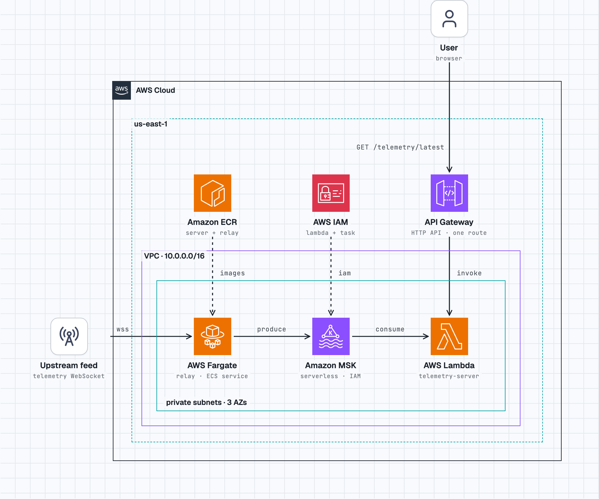

# Telemetry System

Two Go services for device telemetry:

- **Telemetry Relay** (`cmd/relay`): hosts the device WebSocket ingest endpoint at `ws://<host>:9000/telemetry` and publishes each received record to Kafka.
- **Telemetry Server** (`cmd/telemetry-server`): consumes from Kafka, buffers recent records in memory, and serves the latest telemetry over HTTP.

Flow: `device → relay (WebSocket) → Kafka → telemetry-server → HTTP clients`.

## Configuration

Copy `.env.example` to `.env` and adjust values as needed.

Shared settings:

- `KAFKA_BROKERS` (required by both binaries): Kafka bootstrap broker addresses, comma-separated
- `KAFKA_TOPIC` (optional): Kafka topic name, default `telemetry.raw`
- `APP_ENV` (optional): application environment, default `development`. When set to `production` (case-insensitive) and `LOG_FORMAT` is not explicitly set, logs default to JSON; otherwise logs default to text
- `LOG_LEVEL` (optional): log level, default `info`. Allowed values: `debug`, `info`, `warn`, `error` (case-insensitive)
- `LOG_FORMAT` (optional): log output format, default derived from `APP_ENV` (`production` => `json`, otherwise `text`). Allowed values: `json`, `text` (case-insensitive)

Telemetry server:

- `HTTP_ADDR` (optional): HTTP listen address, default `:8080`

Relay:

- `WS_ADDR` (optional): WebSocket listen address for device connections, default `:9000`. The ingest path is fixed at `/telemetry`.

CLI flags override environment variables.

Telemetry server flags:

- `-kafka-brokers=<brokers>`
- `-kafka-topic=<topic>`
- `-http-addr=<addr>`
- `-app-env=<env>`
- `-log-level=<level>`
- `-log-format=<format>`

Relay flags:

- `-ws-addr=<addr>`
- `-kafka-brokers=<brokers>`
- `-kafka-topic=<topic>`
- `-app-env=<env>`
- `-log-level=<level>`
- `-log-format=<format>`

Invalid `LOG_LEVEL` or `LOG_FORMAT` values cause startup to fail with a configuration error. The relay also fails fast when `WS_ADDR` is malformed or `KAFKA_BROKERS` is missing. Application logs are emitted with runtime/request context; request-scoped logs include `request_id` when available.

## Architecture

- `cmd`: start command and dependency injection.
  - `relay`: host the device WebSocket endpoint and publish records to Kafka.
  - `telemetry-server`: consume Kafka records, buffer them, and serve HTTP.
- `internal`:
  - `relay`: relay configuration and the Kafka publish handler.
  - `telemetry`: store and present telemetry values via HTTP.
- `pkg`: modules without domain-related logic.
  - `ws`: WebSocket server used by the relay, plus a retained dialing client.
  - `kafka`: Kafka publisher and consumer adapters.
  - `buffer`: in-memory ring buffer.

See [`docs/architecture.md`](docs/architecture.md) for diagrams and design decisions.

### Cloud deployment



[Costs estimation](terraform/option-a-lambda-apigw/env/prod/cost.csv)

## Run

Telemetry server:

```bash
# using environment variables
KAFKA_BROKERS=localhost:9092 go run ./cmd/telemetry-server

# with CLI flags (flags override env vars)
go run ./cmd/telemetry-server \
  -kafka-brokers=localhost:9092 \
  -http-addr=:8080 \
  -log-level=debug
```

Relay:

```bash
# listen on the default :9000 and publish to Kafka
KAFKA_BROKERS=localhost:9092 go run ./cmd/relay

# explicit listen address and logging configuration
go run ./cmd/relay \
  -ws-addr=:9000 \
  -kafka-brokers=localhost:9092 \
  -app-env=production \
  -log-level=info \
  -log-format=json
```

Build:

```bash
go build ./cmd/...
```

## HTTP API

OpenAPI specification: [`docs/openapi.yaml`](docs/openapi.yaml)

### `GET /telemetry/latest`

Query parameters:

- `n` (required): integer `1 <= n <= 100`

Behavior:

- Returns `200 OK` with a JSON array of the latest `n` buffered telemetry records.
- Records are sorted in descending order by payload `ts`.
- Each record is returned as the original JSON object received (pass-through).
- If fewer than `n` records are buffered, all available records are returned.
- Invalid, missing, or out-of-range `n` returns `400 Bad Request` with a JSON error body: `{"error":"..."}`.
- Excessive request rates return `429 Too Many Requests` with a JSON error body.
- Request timeouts return `503 Service Unavailable`.
- Unexpected failures return `500 Internal Server Error` with a JSON error body.
- Responses include an `X-Request-Id` correlation header.

Example:

```bash
curl "http://localhost:8080/telemetry/latest?n=5"
```

## Development

### Hot reload (Air)

Install [Air](https://github.com/air-verse/air) and run the telemetry server with hot reload:

```bash
air
```

Air uses `.air.toml` to rebuild and restart `./cmd/telemetry-server` on changes. The relay is run separately (see below) since it is a second process.

### Pre-commit hooks (Lefthook)

This project uses [Lefthook](https://github.com/evilmartians/lefthook) (Go-based git hooks manager) to run formatting checks, linting, and tests before commits.

```bash
# install lefthook (example)
go install github.com/evilmartians/lefthook@latest

# install git hooks
lefthook install
```

Pre-commit runs `gofmt` checks, `golangci-lint run ./...`, and `go test -race ./...` (see `lefthook.yml`). Ensure `golangci-lint` is installed locally.

### Docker

Build and run the telemetry server with the multi-stage Dockerfile (uses BuildKit cache mounts):

```bash
docker build -t telemetry-server .
docker run --rm -p 8080:8080 \
  -e KAFKA_BROKERS=host.docker.internal:9092 \
  telemetry-server
```

### Local Kafka (Docker Compose), relay, and devices

A local single-broker Kafka (KRaft) service is provided for development:

```bash
docker compose up -d
# Broker for host clients: localhost:9092
```

Start the telemetry server and the relay in separate terminals:

```bash
# terminal 1: consume from Kafka and serve HTTP
KAFKA_BROKERS=localhost:9092 go run ./cmd/telemetry-server

# terminal 2: host the device WebSocket endpoint and publish to Kafka
KAFKA_BROKERS=localhost:9092 WS_ADDR=:9000 go run ./cmd/relay
```

With [websocat](https://github.com/vi/websocat) installed, send device records to the relay:

```bash
make device
# equivalent to: websocat ws://localhost:9000/telemetry
```

Then read them back over HTTP:

```bash
curl "http://localhost:8080/telemetry/latest?n=3"
```

Optional logging env vars (`APP_ENV`, `LOG_LEVEL`, `LOG_FORMAT`) follow the same conventions as the telemetry server. Startup fails with a clear error if required relay configuration is missing or invalid. When Kafka is unavailable long enough for publish retries to be exhausted, the relay closes only the affected device connection with a server-error status; the device is expected to reconnect and resend.

### CI

GitHub Actions (`.github/workflows/ci.yml`) runs formatting checks, `golangci-lint`, `go test -race ./...`, a build, and a Docker image build with GitHub Actions cache on pushes and pull requests.

## Notes

- Buffering is in-memory only (latest 1000 records); data is not persisted across restarts.
- Devices are responsible for reconnecting and resending when the relay closes their connection (for example, after a Kafka publish failure).
- Telemetry payloads are treated as pass-through JSON; `ts` is used for ordering.
