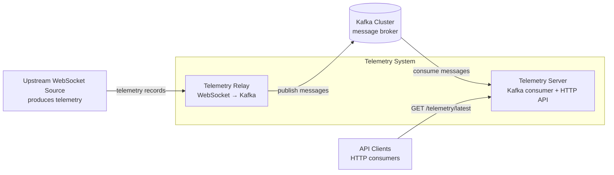
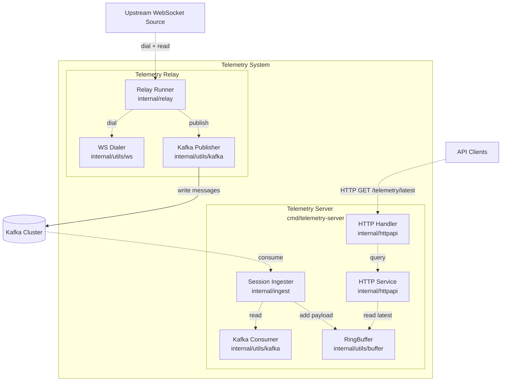

# Architecture

Telemetry system built in Go, consisting of two binaries: a **Telemetry Relay** (`cmd/relay`) that forwards WebSocket telemetry to Kafka, and a **Telemetry Server** (`cmd/telemetry-server`) that consumes from Kafka and serves records over HTTP.

## Open Questions Resolved

### Exactly-once semantics

**Decision: At-least-once, not exactly-once.**

The architecture currently provides **at-least-once** delivery:
- The Kafka publisher retries with exponential backoff + jitter on failure (see `internal/utils/kafka/publisher.go`).
- The ingester does not deduplicate messages; if a message is consumed, buffered, and then the consumer re-delivers it after a rebalance, the buffer may contain duplicates.

Achieving **exactly-once** would require:
- **Idempotent producer** (Kafka transactions with `transactional.id`) on the relay side, and
- **Idempotent consumer** (deduplication by message key/offset in the ingester or buffer layer).

This was deliberately deferred because the buffer is ephemeral (in-memory, lost on restart) and downstream consumers can tolerate occasional duplicates.

### `TelemetryWSURL` removed from telemetry-server config

**Resolved: Removed.**

`TelemetryWSURL` was a required field in `internal/config/config.go` (used only by `cmd/telemetry-server`). After migrating `SessionIngester` from WebSocket to a Kafka consumer (change `ingest-from-kafka-consumer`, now archived), the telemetry-server binary no longer reads from WebSocket and no longer needs a WebSocket URL. The field, its flag (`-telemetry-ws-url` / `TELEMETRY_WS_URL`), and its validation rule were removed from `internal/config/config.go`.

`TelemetryWSURL` remains in `internal/relay/config.go` and is still used by `cmd/relay/main.go`, where the relay continues to dial an upstream WebSocket source.

---

## System Context Diagram

## Container Diagram

## Component Responsibilities

| Component | Package | Responsibility |
|---|---|---|
| Relay Runner | `internal/relay` | Dial upstream WebSocket, read telemetry records, publish to Kafka. Runs a reconnect loop until context is canceled. |
| WS Dialer | `internal/utils/ws` | Injectable `Dialer`/`Conn` interfaces for WebSocket connections (CoderDialer implementation). |
| Kafka Publisher | `internal/utils/kafka` | Injectable `Publisher` interface; publishes telemetry records to Kafka with retry. |
| Session Ingester | `internal/ingest` | Consume from Kafka consumer, append payloads to buffer. Context cancellation stops ingestion; non-context errors are wrapped. |
| Kafka Consumer | `internal/utils/kafka` | Injectable `Consumer` interface; wraps `kafka-go.Reader` via `kafkaConsumerAdapter`. |
| RingBuffer | `internal/utils/buffer` | Fixed-capacity (1000) in-memory ring buffer; ephemeral across restarts; serves latest records sorted by `ts` descending. |
| HTTP Handler | `internal/httpapi` | Expose `GET /telemetry/latest`; validate `n` param; write JSON responses. |
| HTTP Service | `internal/httpapi` | Query the buffer for latest `n` records; return as JSON response. |

## Key Design Decisions

1. **Kafka as durable buffer** — The relay publishes to Kafka; the ingester consumes from Kafka. This decouples the two binaries: the relay can run independently of the server, and messages survive temporary server downtime.

2. **Interface-based injection** — `kafka.Publisher`, `kafka.Consumer`, `ws.Dialer`, and `Buffer` are all interfaces, enabling unit testing with mock implementations and future provider substitution.

3. **Ephemeral buffer** — The RingBuffer is in-memory only (1000 records max, no persistence). Kafka is the source of truth for durable message storage.

4. **At-least-once delivery** — Publishers retry on failure; consumers do not deduplicate. Duplicates may appear in the buffer after consumer rebalances.

## Open Questions

- **Consumer offset commit strategy**: Not specified. Delegated to the Kafka client library (`kafka-go.Reader` default behavior).
- **TLS / authentication**: No TLS or auth configuration is visible for WebSocket or Kafka connections. Required for production deployment.
- **Consumer group ID**: Hardcoded as `"telemetry-ingest"` in `cmd/telemetry-server/main.go`; should be configurable.