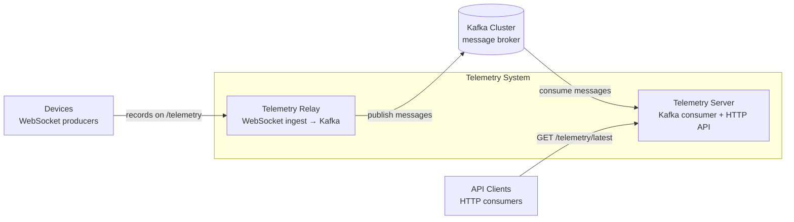
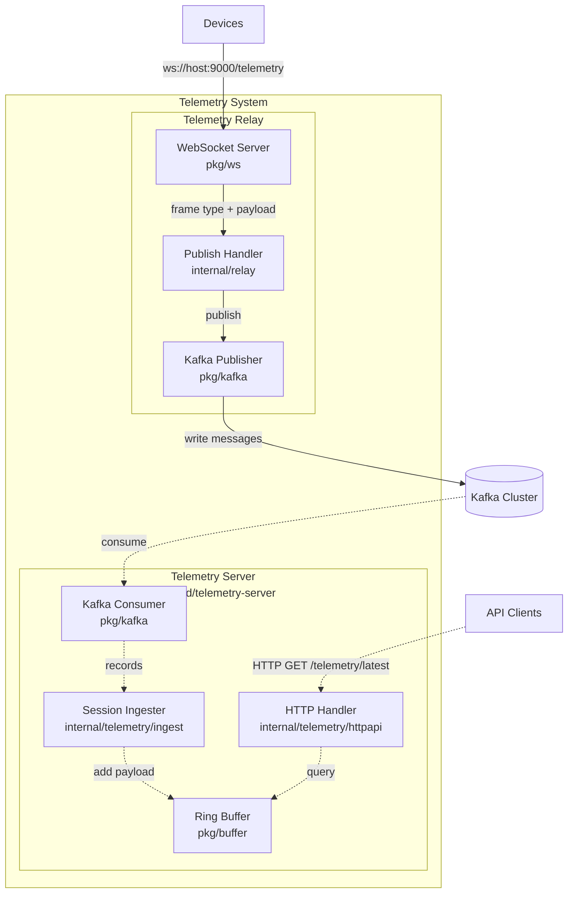

# Architecture

Telemetry system built in Go, consisting of two binaries: a **Telemetry Relay** (`cmd/relay`) that hosts the device WebSocket ingest endpoint and publishes telemetry to Kafka, and a **Telemetry Server** (`cmd/telemetry-server`) that consumes from Kafka and serves records over HTTP.

## Open Questions Resolved

### Exactly-once semantics

**Decision: At-least-once, not exactly-once.**

The architecture currently provides **at-least-once** delivery:
- The Kafka publisher (`pkg/kafka`) retries writes using the writer's configured delivery attempts.
- Devices retry after the relay closes their connection, so a record can be published more than once.
- The ingester does not deduplicate messages; if a message is consumed, buffered, and then the consumer re-delivers it after a rebalance, the buffer may contain duplicates.

Achieving **exactly-once** would require:
- **Idempotent producer** (Kafka transactions with `transactional.id`) on the relay side, and
- **Idempotent consumer** (deduplication by message key/offset in the ingester or buffer layer).

This was deliberately deferred because the buffer is ephemeral (in-memory, lost on restart) and downstream consumers can tolerate occasional duplicates.

### WebSocket ingest lives in the relay

**Resolved: The relay hosts the ingest server (ADR-0009).**

Devices connect to the relay at the fixed path `/telemetry` on `WS_ADDR` (default `:9000`). The relay accepts concurrent connections and publishes each received record to Kafka. `cmd/telemetry-server` has no WebSocket ingest route; it consumes Kafka and exposes the HTTP read API. The relay no longer dials an upstream source, and the WebSocket client in `pkg/ws` remains available but is not wired into either binary.

## System Context Diagram

## Container Diagram

## Component Responsibilities

| Component | Package | Responsibility |
|---|---|---|
| WebSocket Server | `pkg/ws` | Accept concurrent device connections on `/telemetry`, enforce the read limit, deliver messages to a handler, and close connections with explicit status codes and reasons. |
| WebSocket Client | `pkg/ws` | Dialing client retained for upstream-style use; not wired into the relay or telemetry server. |
| Publish Handler | `internal/relay` | Publish each received record to Kafka unchanged; return an error so the server closes the affected connection. |
| Relay Configuration | `internal/relay` | Load `WS_ADDR` (default `:9000`), `KAFKA_BROKERS`, `KAFKA_TOPIC`, and logging settings; validate before startup. |
| Kafka Publisher | `pkg/kafka` | Publish telemetry records to Kafka with configurable delivery attempts; safe for concurrent use. |
| Session Ingester | `internal/telemetry/ingest` | Consume from Kafka consumer, append payloads to buffer. Context cancellation stops ingestion; non-context errors are wrapped. |
| Kafka Consumer | `pkg/kafka` | Injectable `Consumer` interface; wraps `kafka-go.Reader` via an adapter. |
| RingBuffer | `pkg/buffer` | Fixed-capacity (1000) in-memory ring buffer; ephemeral across restarts; serves latest records sorted by `ts` descending. |
| HTTP Handler | `internal/telemetry/httpapi` | Expose `GET /telemetry/latest`; validate `n` param; write JSON responses. |
| HTTP Service | `internal/telemetry/httpapi` | Query the buffer for latest `n` records; return as JSON response. |

## Key Design Decisions

1. **Relay owns ingest** — Devices connect to the relay, which is the single WebSocket entry point. The relay publishes to Kafka and the telemetry server consumes from it, so the two binaries remain independently deployable and restartable.

2. **Transport and policy are separated** — `pkg/ws` owns handshakes, read limits, and close semantics; `internal/relay` owns the decision to accept a record. The handler is a concrete function type, so the server does not depend on Kafka or on a transport abstraction with only one implementation.

3. **Ephemeral buffer** — The RingBuffer is in-memory only (1000 records max, no persistence). Kafka is the source of truth for durable message storage.

4. **At-least-once delivery with device retries** — The publisher retries writes, and a failed publish closes the affected device connection with a server-error status. Devices reconnect and resend; the relay does not buffer records while Kafka is unavailable.

5. **Fixed ingest contract** — Only `/telemetry` is upgraded to a WebSocket; other paths are served as ordinary HTTP 404s. The listen address is configurable, the path is not.

## Open Questions

- **Consumer offset commit strategy**: Not specified. Delegated to the Kafka client library (`kafka-go.Reader` default behavior).
- **TLS / authentication**: No TLS or auth configuration is visible for the device WebSocket endpoint or Kafka connections. Required for production deployment.
- **Consumer group ID**: Hardcoded as `"telemetry-ingest"` in `cmd/telemetry-server/main.go`; should be configurable.
