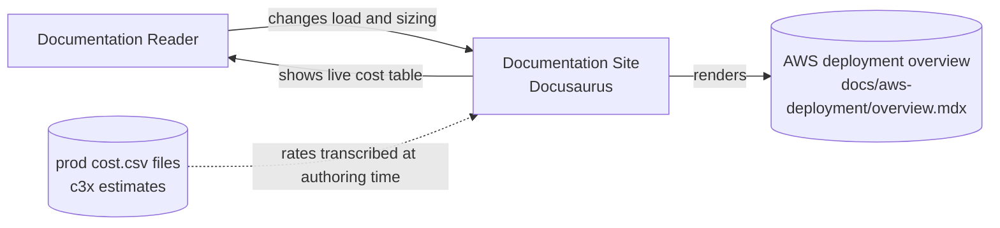
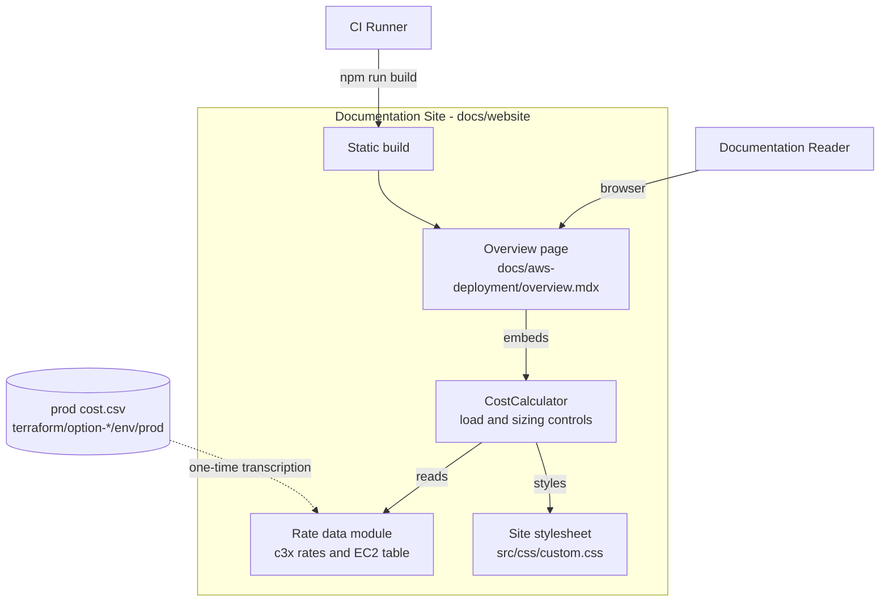

# Design

## Context

See `proposal.md` for motivation and the delta spec for required behavior. The documentation site is Docusaurus 3.10.2 with two content plugin instances: `docs` sources `docs/` at `/docs` and `specs` sources `openspec/specs/` at `/specs`. `docs/aws-deployment/overview.mdx` belongs to the `docs` instance.

`docs/website/src/components/ApiReference/index.tsx` is the existing precedent: a component under `src/components/` imported into an MDX page with `@site/...`. It is static; there are no stateful components and no test framework. Verification is `npm run typecheck` and `npm run build`; CI (`docs.yml`) runs `npm ci` and `npm run build` only.

`make tf-estimate` runs `c3x estimate --path ... --usage ... --format csv > .../cost.csv`. The checked-in `cost.csv` files are the only machine-readable pricing data in the repo; neither `terraform/` nor `c3x-usage.yml` contains rates. The published figures reflect c3x defaults (512 MB Lambda, one 0.25 vCPU / 512 MB Fargate task, three NAT gateways, 730 hours), not the prod tfvars overrides. Sizing alternatives are not in any CSV, so their rates must be supplied from public us-east-1 Linux on-demand prices.

ADR 0010 establishes Docusaurus and excludes a deployment pipeline. No existing ADR changes and no new ADR is required.

Diagram choices: purpose is an addition to existing code, format is Mermaid, and rigor is lightweight C4-inspired, following the Mermaid diagrams already used in `docs/architecture.md` and the earlier version of this design.

## Goals / Non-Goals

**Goals:**

- Recalculate per-resource line items and option totals in the browser from reader-editable load and sizing inputs.
- Reproduce the published c3x baseline exactly and scale variable charges linearly with load and sizing.
- Disclose the assumptions that remain fixed and keep MSK data non-editable.
- Reuse the existing MDX component pattern and existing dependencies only.

**Non-Goals:**

- No c3x invocation, network request, or API at runtime.
- No new npm packages or test framework.
- No changes to Terraform, `c3x-usage.yml`, `cost.csv`, Go code, or ADRs; Terraform defaults stay t3.micro and one 0.25 vCPU / 512 MB Fargate task.
- No arbitrary AWS region, pricing model, or instance family; the rate table is a fixed set of us-east-1 on-demand choices.

## Decisions

### Edit the existing page through an embedded component

Add `docs/website/src/components/CostCalculator/` and import it into `docs/aws-deployment/overview.mdx` with `@site/src/components/CostCalculator`, replacing only the static cost table. This follows the `ApiReference` precedent and keeps `docs/` as the single source of truth.

Alternatives: a standalone page would need manual navbar, sidebar and footer links and would split the cost narrative; injecting a script into the MDX would bypass normal hydration. Both were rejected.

### One typed data module with a small sizing rate table

A single TypeScript module holds the c3x rates, the fixed quantities, the default inputs and two extra tables: EC2 hourly rates by instance type and allowed Fargate CPU/memory pairs. The EC2 table uses us-east-1 Linux on-demand list prices verified on 2026-11-24: t3.micro 0.0104 (matching the prod `cost.csv`), t2.micro 0.0116, t3.small 0.0208, t3.medium 0.0416 USD/hour. Fargate keeps the c3x rates of 0.04048 USD per vCPU-hour and 0.004445 USD per GB-hour.

No CSV or YAML is imported at runtime. Alternatives: importing `cost.csv` would couple the website to the Terraform directory layout and still would not price the alternatives; calling a pricing API would add a runtime dependency and contradict ADR 0010's local-only scope. Both were rejected. The trade-off is rate drift, handled below.

### Fixed time, variable load and sizing, line-item rounding

EC2 cost is `730 × rate × instanceCount`. Fargate cost is `730 × cpu × taskCount × 0.04048 + 730 × memoryGB × taskCount × 0.004445`. Load-driven charges use the c3x unit rates: HTTP API `requests × 0.000001`; Lambda requests `requests × 0.0000002`; Lambda duration `requests × duration_s × 0.5 GB × 0.0000166667`; ECR `storage_gb × 0.10 × 2`; CloudWatch Logs `ingested × 0.50 + stored × 0.03 + scanned × 0.005`; DynamoDB storage `storage_gb × 0.25`. MSK stays at `547.50 + 1.10 = 548.60`, the Function URL stays free, and DynamoDB write/read charges display as `0.00` at the baseline scale.

Each line item is rounded to two decimals before summing, so `730 × 0.0015 = 1.095` becomes `1.10` and the baseline totals match `673.63`, `672.63` and `136.11`.

### Constrained sizing controls with explicit validation

EC2 type, Fargate CPU/memory and both counts are chosen from fixed dropdown options or numeric fields, not free text. Counts accept non-negative integers only; other inputs reject negative and non-numeric values. Invalid values show an inline message and leave the last valid calculation in place.

Alternatives: free-text instance types would allow values the rate table cannot price, and independent CPU/memory dropdowns would allow combinations Fargate does not support. Both were rejected in favour of curated pairs.

### Styles in the existing stylesheet

Add calculator classes to `src/css/custom.css` using `--ifm-*` variables and `[data-theme='dark']` overrides, following the file's existing BEM-ish naming. CSS modules or inline styles were rejected as inconsistent with the site.

### Verification without new dependencies

`npm run typecheck` and `npm run build` are the automated checks; a browser pass compares baseline totals, a load change, an EC2 sizing change, a Fargate sizing change and an invalid input with the delta spec. Adding a JavaScript test framework would require a new devDependency and project approval, so it is deferred.

### System context

- The documentation site is the only system in scope; the reader is its actor.
- The overview Markdown stays the authoritative page source and gains a live table.
- The c3x CSVs and public price pages are external inputs used once when the data module is written, not runtime dependencies.
- No hosting or deployment target is shown because ADR 0010 excludes one.

### Container

- `docs/website/` is the single runnable unit; its component, rate module, stylesheet and build step are internal parts.
- The MDX page is the integration point; it embeds the calculator in place of the static table.
- The rate module is a compile-time copy of the source prices, so the calculator never contacts c3x or a pricing service.
- CI exercises the same build as local development, with no deploy step.

## Risks / Trade-offs

- [Risk] The rate module drifts from the c3x CSVs or public prices → Mitigation: name sources and verification date in the module, include a refresh step in the tasks, and check baseline totals before release.
- [Risk] Rounding differs from c3x → Mitigation: round every line item to two decimals before summing and assert the three published totals during verification.
- [Risk] The MSK data input looks meaningful but has no effect on c3x cost → Mitigation: present it as a fixed assumption with an explanation in the page prose.
- [Risk] No JavaScript test framework → Mitigation: typecheck, build and a browser check of baseline and changed inputs; adding a framework needs approval first.
- [Risk] A stateful component behaves differently under MDX hydration → Mitigation: mirror the existing `ApiReference` import pattern and inspect the built page.
- [Trade-off] Only curated EC2 types and Fargate sizing pairs are offered; other instance families and pricing models are deliberately excluded.

## Migration Plan

1. Extend the typed rate module with the EC2 rate table, Fargate sizing pairs and defaults; keep the c3x baseline rates.
2. Update the calculation for instance counts and Fargate CPU/memory, preserving line-item rounding.
3. Add the sizing controls with validation and update the fixed-assumption disclosure.
4. Run `npm run typecheck` and `npm run build`, then verify baseline, load-change, EC2-change, Fargate-change and invalid-input scenarios in the browser.
5. Roll back by restoring the previous rate module, component and disclosure. No data migration is needed.
