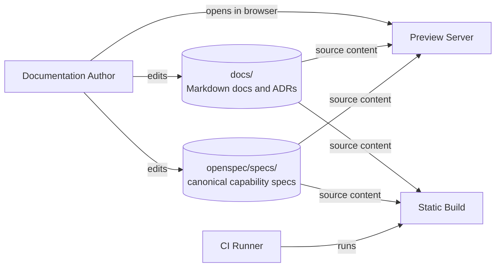
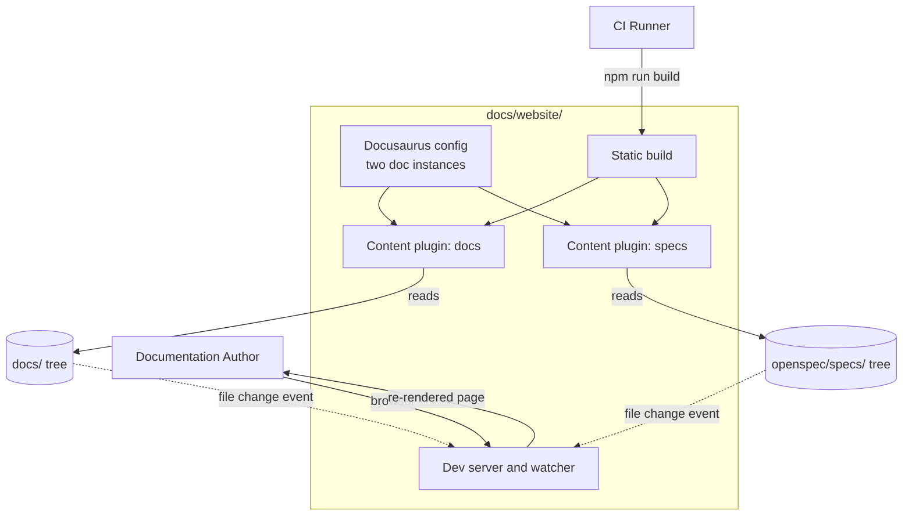

# Design

## Context

See `proposal.md` for motivation. The repository has two Go binaries, Markdown documentation in `docs/`, and canonical capability specs in `openspec/specs/`. There is no site scaffold, `package.json`, or Node toolchain checked in; Node and npm are available locally. ADR-0010 proposes Docusaurus and is currently `proposed`.

Constraints: `docs/` and `openspec/specs/` are the authoritative sources and must not be duplicated into the site. The Go runtime, Kafka, and WebSocket behaviour are out of scope. In-progress artifacts under `openspec/changes/` are not published.

Assumptions: the site is developed and built locally and in CI; no hosting target is chosen yet. Diagram style follows the existing Mermaid `flowchart` diagrams in `docs/architecture.md`.

## Goals / Non-Goals

**Goals:**

- Publish both Markdown trees as one navigable site with no copied content.
- Give contributors a single-command preview that reloads when either tree changes.
- Make the static build verifiable in CI.
- Keep all runtime architecture unchanged.

**Non-Goals:**

- No deployment or hosting pipeline.
- No publishing of in-progress change artifacts.
- No changes to Go code, Kafka clients, WebSocket handling, or OpenSpec specs.

## Decisions

### Two content sources, one site

Use two `@docusaurus/plugin-content-docs` instances pointing at `..` (the `docs/` tree) and `../../openspec/specs`, each with its own id and sidebar. The `docs/website/` subtree is excluded from published content. The site lives in `docs/website/` so its config and dependencies do not mix with Go sources.

Alternatives: MkDocs (adds a Python toolchain and needs extra work for multiple doc roots); GitHub Markdown rendering (no local preview or unified navigation); copying source files into the site (introduces drift). See ADR-0010 for the full comparison.

### Native watching instead of symlinks or sync scripts

Rely on the content plugin paths so the dev server watches the real source directories. Symlinks were rejected because watchers do not reliably follow directory symlinks; copy-on-change scripts were rejected because they duplicate content.

### Build-only verification

`npm run build` produces static output and is run by CI when `docs/website/`, `docs/`, or `openspec/specs/` change. No deploy step is added; hosting can be decided later without changing the specs.

### TypeScript with a pinned Node version

Use the Docusaurus TypeScript defaults and npm, with `.nvmrc` matching the supported local Node version. This keeps one predictable toolchain for contributors and CI.

### System context

- The documentation site is the only new system; authors and CI are the actors that interact with it.
- `docs/` and `openspec/specs/` remain external source trees and are not moved or copied.
- The preview serves both trees; the static build consumes the same sources for CI verification.
- No deployment target is shown because none is in scope.

### Container

- `docs/website/` is the single new deployable/runnable unit; its config, plugins, dev server, and build are components inside it.
- The two content plugins own their respective source trees and give each tree its own sidebar.
- The watcher receives change events from both source trees and the dev server re-renders the affected page.
- CI exercises the same build component through an npm script, so local and CI verification are equivalent.

## Risks / Trade-offs

- [Risk] File watching misses changes outside `docs/website/` → Mitigation: configure explicit plugin paths and smoke-check an edit in each tree before completing the work.
- [Risk] Existing Markdown front matter or relative links break rendering → Mitigation: keep source files unchanged where possible and let `npm run build` surface broken content.
- [Risk] Node version drift between contributors and CI → Mitigation: `.nvmrc`, pinned dependencies, and a CI build check.
- [Risk] CI does not rebuild when a spec changes → Mitigation: trigger the build check on `docs/` and `openspec/specs/` paths as well as `docs/website/`.
- [Trade-off] In-progress change artifacts remain browsable only in the repository, not on the site; this is intentional.

## Migration Plan

1. Add the `docs/website/` scaffold, `package.json`, TypeScript config, and `.nvmrc`.
2. Configure the two content plugins and their sidebars; add `start` and `build` scripts.
3. Add README instructions and the CI build check with path filters.
4. Verify locally: `npm run start`, edit a file in `docs/` and in `openspec/specs/`, and confirm both pages reload; then run `npm run build`.
5. Roll back by removing `docs/website/`, `.nvmrc`, and the README and CI additions. No data migration is needed because source files are never moved or copied.
