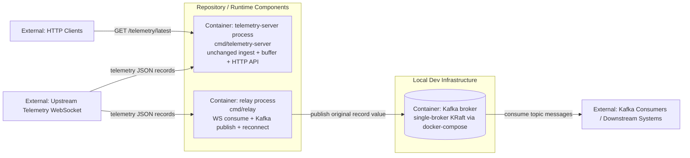

# Design

## Context

See `proposal.md` (Why/What) and `specs/telemetry-kafka-relay/spec.md` for motivation and required behavior. The current system is a single Go process (`cmd/telemetry-server`) that ingests telemetry from a configured upstream WebSocket, buffers recent records in memory, and serves `GET /telemetry/latest` (ADR 0004). Existing runtime code and behavior MUST remain unchanged.

**C4 assumptions:** existing system plus additive relay capability, lightweight C4-inspired container view, plain Mermaid `flowchart`. Deployment detail is limited to local Docker Compose for Kafka; production deployment topology is out of scope.

## Goals / Non-Goals

**Goals:**
- Add a standalone `cmd/relay` binary that publishes upstream telemetry JSON records to Kafka using explicit runtime configuration.
- Provide local Kafka infrastructure via `docker-compose.yml` (single broker, KRaft) for development/testing.
- Preserve all existing `cmd/telemetry-server` and `internal/*` behavior, interfaces, and tests.
- Handle upstream instability with automatic reconnect/retry semantics for the relay.
- Capture the approved architectural decision in a new ADR (next available number at write time).

**Non-Goals:**
- Modifying existing telemetry-server ingest, buffering, HTTP handlers/middleware, or shared runtime behavior.
- Integrating Kafka publishing into the existing server process or internal pipelines.
- Defining production Kafka topology, security hardening, partitioning strategy, schema registry, or consumer implementations beyond basic publish capability.
- Guaranteeing exactly-once delivery semantics unless explicitly required later (at-least-once publish behavior is acceptable if implied by reconnect/retry).

## Decisions

1. **Independent relay process (`cmd/relay`) instead of hooking existing server**
   - **Rationale:** Satisfies "do not change anything else" for existing app behavior/code and keeps failure domains separate (ADR 0004 remains intact). Reuses the same upstream source independently.
   - **Alternatives:** (a) publish from `telemetry-server`/ingest pipeline — rejected because it requires modifying existing code/behavior; (b) poll `/telemetry/latest` — rejected due to coupling, polling gaps/duplicates, and weaker streaming semantics.

2. **Kafka as the relay target with minimal explicit config**
   - **Rationale:** Meets requested event-streaming integration; required config (`TELEMETRY_WS_URL`, `KAFKA_BROKERS`, `KAFKA_TOPIC`, optional log envs) keeps behavior observable and testable. Default topic suggestion: `telemetry.raw`. Publish original JSON record bytes as message value (no key/headers by default).
   - **Alternatives:** other brokers/protocols — out of scope for this change.

3. **Local Compose provides Kafka only (KRaft, single broker)**
   - **Rationale:** Minimal dev infrastructure aligned with request; avoids coupling compose lifecycle to app binaries. KRaft avoids ZooKeeper dependency.
   - **Alternatives:** include relay/server containers in compose — deferred; increases scope and operational assumptions.

4. **Resilient upstream consumption in relay**
   - **Rationale:** Upstream is unstable (per existing system context); relay must reconnect with bounded retry/backoff and resume publishing after reconnect.
   - **Alternatives:** fail-fast on disconnect — rejected as unreliable for intended use.

5. **Minimal necessary non-runtime edits allowed for usability**
   - **Rationale:** `go.mod`/`go.sum`, `.env.example`, and README notes may be required to build/run/document relay and compose; existing application code/tests/runtime behavior remain unchanged.
   - **Alternatives:** strict no-file changes outside new additions — rejected because dependency manifests/docs are needed for a usable deliverable.

6. **ADR handling**
   - **Rationale:** Approved new ADR will record Kafka + Compose + separate relay process decision. Use next available ADR number at write time to avoid collision with other in-progress ADR drafts.

## Risks / Trade-offs

- **[Kafka client dependency and API choice]** → Keep relay implementation isolated under new command/packages; pin dependency in manifests and validate build/tests for modified scope.
- **[Duplicate ingestion of upstream stream]** (relay and telemetry-server both connect independently) → Accepted trade-off to avoid changing existing server; document operational implication.
- **[At-least-once/duplicate publishes across reconnects or producer retries]** → Acceptable unless stricter semantics are later specified; preserve record content and make behavior explicit in implementation/tests as applicable.
- **[Compose/dev environment drift from production Kafka]** → Limit compose to local dev convenience; avoid encoding production assumptions.
- **[ADR numbering collision with in-progress changes]** → Select next available ADR number at write time and update index consistently.

## Migration Plan

1. Add `docker-compose.yml` and relay-related config/docs/examples as scoped.
2. Add `cmd/relay` and any new relay-specific packages/dependencies without modifying existing app code paths.
3. Add/update approved ADR file and `docs/adr/README.md` at implementation time using next available number.
4. Validate: start compose Kafka, run relay with valid config against upstream, confirm Kafka messages contain original telemetry records; confirm existing telemetry-server behavior/tests unaffected.

**Rollback:** remove newly added relay/compose/ADR/doc artifacts and dependency additions introduced by this change; no existing runtime migrations required.

## Open Questions

- Should relay message keys/headers be added later for partitioning or tracing (currently none by default)?
- Should compose optionally include the relay container in a follow-up change for one-command local startup?
