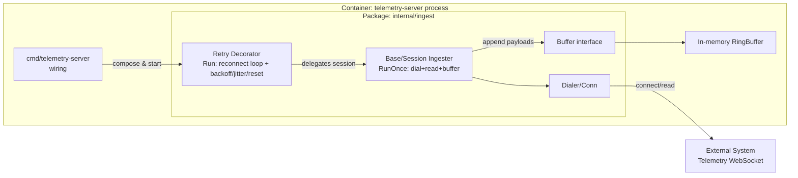

# Design

## Context

`internal/ingest` currently implements both single-session WebSocket ingestion (`RunOnce`) and resilient reconnect/backoff+jitter looping (`Run`) in one `Ingester` type. `cmd/telemetry-server` starts ingestion via `ing.Run(...)`, and reconnect behavior/tests depend on policy hooks currently stored on `Ingester`. See `proposal.md` for motivation and scope (`skip_specs: true`, behavior-preserving refactor, ADR-0004/spec compatible).

**Assumptions (diagramming):** existing codebase refactor; format Mermaid (plain `flowchart`), lightweight C4-inspired component view of the ingestion components inside the single `telemetry-server` process/container; no deployment/runtime boundary changes.

## Goals / Non-Goals

**Goals:**
- Separate session ingestion from retry/reconnect policy using a decorator: base/session ingester handles one connect+read session (`RunOnce` semantics), retry decorator owns resilient `Run` loop and backoff policy.
- Move retry policy/config/hooks (`baseDelay`, `maxDelay`, `jitter`, `sleep`, `successMin`) to the retry decorator and update internal tests/callers (`cmd/telemetry-server`, `internal/ingest` tests) accordingly.
- Preserve reconnect semantics and observable behavior (exponential backoff with jitter, capped, reset after healthy successful session, cancellation/error handling, logging intent).

**Non-Goals:**
- No changes to buffering, HTTP API, OpenAPI, telemetry payload handling, or upstream dial protocol behavior.
- No new dependencies, no spec/ADR changes, and no retry-policy tuning unless required to preserve existing behavior exactly.

## Decisions

### 1. Decorator boundary: base session + retry decorator
- **Decision:** Introduce a base/session ingester responsible for a single session (`RunOnce`: dial, log connect, read/append until disconnect or ctx cancel, close best-effort, return ctx or read/dial error). Introduce a retry decorator that wraps the base ingester and implements `Run(ctx, url)` as the resilient reconnect loop.
- **Rationale:** Matches Q2 (A), cleanly isolates policy from session mechanics, and keeps retry logic readable/testable.
- **Alternatives considered:**
  - *Keep combined `Ingester`:* rejected; does not address separation goal.
  - *Outer ingester wrapping a smaller dial/read primitive:* possible but less direct than decorating a session runner.
  - *Formal exported runner interface:* optional; may be used if it simplifies composition/tests, but not required beyond clear decorator structure.

### 2. Retry policy/config ownership
- **Decision:** Store retry policy and test hooks on the retry decorator (`baseDelay`, `maxDelay`, `jitter`, `sleep`, `successMin`) with defaults equivalent to current behavior. `RunOnce`/session behavior remains independent of retry policy except as composed by the decorator.
- **Rationale:** Matches Q3 (A), keeps policy state/config at the boundary that owns it and makes deterministic tests explicit.
- **Alternatives considered:**
  - *Preserve fields on base ingester for compatibility:* rejected for this refactor (intentional internal API cleanup, Q4 allows caller/test updates).
  - *Separate config/options object:* viable, but direct fields/constructor wiring is sufficient and easy to mirror in tests.

### 3. Internal API and call-site updates
- **Decision:** Update `internal/ingest` constructors/types and callers (`cmd/telemetry-server/main.go`, `internal/ingest/ingest_test.go`, `internal/ingest/reconnect_test.go`) to compose base + decorator. Existing `RunOnce`-focused tests should target the base/session ingester; reconnect-loop tests should target the retry decorator.
- **Rationale:** Matches Q4 (A) and keeps each test aligned with the responsibility it verifies.
- **Alternatives considered:**
  - *Compatibility wrappers preserving old signatures/field access:* rejected; adds transitional complexity without need.

### 4. Behavior preservation and validation boundaries
- **Decision:** Preserve current control flow and observable outcomes: attempt counting/reset based on `successMin`, exponential delay calculation/cap/jitter, context cancellation returns, and log messages/fields at equivalent points. Apply validation/checks at boundary/extreme decision points (e.g. ctx done before attempt, attempt normalization/cap in delay calc, sleep cancellation) rather than duplicating intermediate checks, consistent with project guidance.
- **Rationale:** Minimizes regression risk for ADR-0004 behavior and keeps logic clear.

## Component View (C4-inspired, lightweight)

**Notes:** boundaries unchanged (same single process, same upstream and in-memory buffer dependencies). Diagram focuses on internal ingest composition after refactor.

## Risks / Trade-offs

- **[Retry-policy drift] →** Preserve existing defaults/formulas/reset conditions and keep/update deterministic reconnect tests (scripted dialer/sleep/jitter hooks).
- **[API/test breakage from refactor] →** Update all `internal/ingest` call sites/tests in the same change; verify `go test -race ./internal/ingest ./cmd/telemetry-server ./e2e`.
- **[Logging behavior changes] →** Retain equivalent log events/fields in the same logical components (session connect/disconnect, reconnect scheduled) where applicable.
- **[Over-abstraction] →** Keep minimal types needed for decorator split; avoid introducing unnecessary interfaces/helpers beyond the agreed structure.

## Migration Plan

1. Refactor `internal/ingest/ingest.go` into base/session ingester and retry decorator with policy config/hooks on the decorator.
2. Update `cmd/telemetry-server/main.go` to construct and run the composed ingester/decorator.
3. Update `internal/ingest/ingest_test.go` and `internal/ingest/reconnect_test.go` to target the appropriate component and preserve behavior assertions.
4. Run `gofmt -w .`, `go build ./cmd/...`, `go test -race ./internal/ingest ./cmd/telemetry-server ./e2e`, and `golangci-lint run ./internal/ingest ./cmd/telemetry-server ./e2e`.
5. **Rollback:** revert refactor; no data migration or runtime/deployment changes (in-process internal restructuring only).

## Open Questions

- None that would change specs, approach, or task breakdown (behavior-preserving scope and decorator/config/API decisions confirmed; `skip_specs: true`).
