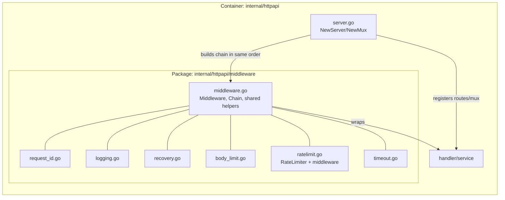

# Design

## Context

`internal/httpapi` currently wires HTTP middleware from a single file (`internal/httpapi/middleware.go`) inside `NewServer` (`internal/httpapi/server.go`). The middleware chain and behavior are already in place (request ID, logging, recovery, body limit, rate limiting, request timeout) and must remain unchanged. See `proposal.md` for motivation and scope (`skip_specs: true`, behavior-preserving refactor).

**Assumptions (diagramming):** existing codebase refactor; format Mermaid (plain `flowchart`), lightweight C4-inspired component view of the HTTP API container internals; rigor kept lightweight because this is a local package-structure change with no runtime boundary changes.

## Goals / Non-Goals

**Goals:**
- Split middleware implementation into `internal/httpapi/middleware` (package `middleware`) with **one file per middleware concern** plus shared primitives in `middleware.go`.
- Preserve runtime behavior, middleware order/effects, exported behavior used by `internal/httpapi`, and HTTP/OpenAPI contract.
- Keep tests passing and update test placement/imports as needed for the new package layout.

**Non-Goals:**
- No endpoint, validation, error-mapping, rate-limit policy, timeout, logging format, or OpenAPI behavior changes.
- No new middleware features (auth/CORS/etc.), no dependency changes, and no spec/ADR changes.

## Decisions

### 1. Package layout: `internal/httpapi/middleware` subpackage (one file per concern)
- **Decision:** Move middleware code to `internal/httpapi/middleware/` with files: `middleware.go` (shared), `request_id.go`, `logging.go`, `recovery.go`, `body_limit.go`, `timeout.go`, `ratelimit.go`.
- **Rationale:** Matches the agreed layout (Q1b), improves cohesion and discoverability without introducing one-package-per-middleware overhead.
- **Alternatives considered:**
  - *Keep single file:* rejected; does not address maintainability/organization goal.
  - *One folder/package per middleware:* rejected for this change per user clarification (wanted one file per middleware, not one middleware per folder/package).
  - *Per-middleware packages under `internal/httpapi/*`:* possible but higher churn and import surface; unnecessary for this scope.

### 2. Shared primitives in `middleware/middleware.go`
- **Decision:** Keep cross-cutting types/helpers together (`Middleware`, `Chain`, `statusRecorder`, request ID context key/accessor, and any shared helpers required by middleware such as JSON/error writing) in `middleware/middleware.go`.
- **Rationale:** Avoids duplication and import cycles while keeping concern-specific middleware logic isolated in separate files.
- **Alternatives considered:**
  - *Duplicate helpers per file:* rejected; increases drift risk.
  - *Separate `core`/`shared` package now:* rejected; extra abstraction not needed for a small internal refactor.

### 3. Call-site updates and compatibility
- **Decision:** Update `internal/httpapi/server.go` to import and call `middleware.*` constructors/helpers (`Chain`, `NewRateLimiter`, middleware factories) with identical configuration/order. Update `internal/httpapi/middleware_test.go` (moved/renamed/split as needed) to target the new package while preserving coverage/expectations.
- **Rationale:** Centralizes middleware registration remains in server config; behavior is preserved by keeping parameters and chain order the same.
- **Alternatives considered:**
  - *Leave wrappers in `package httpapi`:* not necessary; direct migration keeps code clearer if all call sites are updated.

### 4. Behavior-preserving extraction only
- **Decision:** Copy logic as-is (including timeout JSON body/headers behavior as currently implemented), then only make minimal changes required for package boundaries/exports.
- **Rationale:** Reduces regression risk; proposal explicitly excludes behavior/API/spec changes.

## Component View (C4-inspired, lightweight)

**Notes:** boundaries unchanged (all within the `telemetry-server` process/container). This diagram focuses on internal package/component organization; request flow and external dependencies remain as before.

## Risks / Trade-offs

- **[Import cycle / package-boundary friction] →** Keep shared primitives in `middleware/middleware.go` within the same package and limit dependencies to stdlib/internal-safe helpers.
- **[Accidental behavior drift during move] →** Move code with minimal edits, preserve chain order/config values, and run `gofmt`, `go test -race`, `golangci-lint` on modified packages.
- **[Test breakage due to package move/unexported symbols] →** Relocate/update tests to exercise the new package API (exported constructors/helpers) while keeping assertions equivalent.
- **[Error/JSON helper duplication or coupling] →** Reuse or centralize response-writing helpers needed by recovery/rate-limit/timeout paths consistently.

## Migration Plan

1. Create `internal/httpapi/middleware/` files and move middleware concern code + shared primitives with minimal logic changes.
2. Update `internal/httpapi/server.go` imports/calls to `middleware` package (same chain order and settings).
3. Move/update middleware tests to cover the new package; remove old `internal/httpapi/middleware.go`.
4. Run `gofmt -w .`, `go build ./cmd/...`, `go test -race` on modified packages, and `golangci-lint run` on modified packages.
5. **Rollback:** revert the refactor commit/change; no data/runtime migration or deploy-time steps required (in-process code organization only).

## Open Questions

- None that would change the specs, approach, or task breakdown (specs skipped; layout/constraints confirmed).
