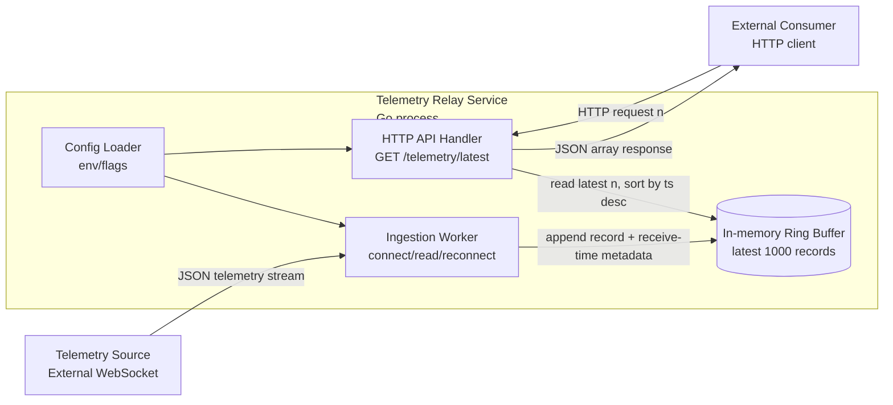

# Design

## Context

This change introduces a new Go service that bridges an unstable device telemetry WebSocket feed and downstream consumers (see `proposal.md` and `specs/telemetry/spec.md`). The upstream sends ~10 JSON telemetry records/sec and becomes unstable every ~10 seconds for a few seconds, so ingestion must tolerate disconnects and preserve recent data in memory for HTTP queries.

Constraints and assumptions (lightweight C4-inspired view, plain Mermaid `flowchart`):
- Greenfield service in this repository (currently no application code under `cmd/`/`internal/`).
- In-memory only buffering (latest 1000 records), no persistence across restarts.
- Telemetry content is treated as opaque JSON for pass-through, except reading payload `ts` for sorting.
- External dependency for WebSocket client is expected and will require explicit approval before adding to `go.mod` (see Decisions/Risks).

## Goals / Non-Goals

**Goals:**
- Continuously ingest telemetry from a single configured WebSocket URL with automatic reconnect (exponential backoff + jitter, reset on success).
- Buffer the latest 1000 records in memory with safe concurrent access (single writer ingest path, multiple HTTP readers).
- Serve `GET /telemetry/latest?n=` with strict validation (`1..100`, else 400), pass-through original JSON records, and results sorted descending by payload `ts`.
- Provide configurable runtime settings (`TELEMETRY_WS_URL`, `HTTP_ADDR` default `:8080`, optional CLI flag overrides) and structured logs for connection lifecycle/retries.

**Non-Goals:**
- Interpreting or validating telemetry business fields beyond what is needed to order responses (`ts`).
- Persistence/durability across restarts, historical query APIs, or data export.
- Authentication/authorization, TLS termination specifics, metrics endpoints, or multi-device fan-in (single upstream only).
- Exactly-once or gap-free delivery guarantees from the unstable upstream (best-effort ingest of received records).

## Decisions

1. **Process structure: single binary with concurrent ingestion and HTTP serving**
   - **Decision:** Run the WebSocket ingestion loop and HTTP server in the same process, coordinated via `context.Context` for startup/shutdown.
   - **Rationale:** Matches the buffering relay scope, keeps state local/in-memory, and minimizes operational complexity.
   - **Alternatives:** Separate ingest and query services with shared storage (rejected: adds persistence/distributed complexity not required).

2. **Storage model: fixed-capacity ring buffer of raw records + parsed sort key**
   - **Decision:** Store each ingested message as the original JSON payload (e.g. `json.RawMessage`/`[]byte`) plus a parsed `ts` value used for ordering; maintain a fixed-capacity ring (1000) overwriting oldest entries.
   - **Rationale:** Preserves pass-through fidelity for responses, bounds memory, and makes serving cheap. Keeping `ts` alongside avoids repeated parsing of unchanged data except initial ingest parse.
   - **Alternatives:** Store only raw bytes and parse `ts` on every query (rejected: unnecessary repeated work); store fully decoded maps/structs (rejected: risks field loss/coercion for pass-through).

3. **Ordering and query behavior: sort by payload `ts` at read time**
   - **Decision:** On `GET /telemetry/latest`, snapshot the latest `n` buffered entries by recency of ingestion, then sort that result set by payload `ts` descending before encoding (or select/sort equivalent over buffered records) to satisfy the API contract.
   - **Rationale:** Spec requires descending order by payload `ts`; sorting up to 1000 records max (or the selected subset) is trivial and robust even if upstream `ts` ordering differs from arrival order.
   - **Alternatives:** Assume arrival order equals `ts` order (rejected: not guaranteed); maintain a globally `ts`-sorted structure on insert (rejected: more complexity for little benefit).

4. **Concurrency control: synchronized buffer access**
   - **Decision:** Protect ring buffer state with a lock (`sync.RWMutex` or `sync.Mutex`) so ingestion writes and HTTP reads are race-free under `go test -race`.
   - **Rationale:** Simple, correct for low write rate (~10/s) and request-driven reads.
   - **Alternatives:** Lock-free ring/channel pipelines (rejected: harder to implement correctly for snapshot/latest-n reads).

5. **Reconnect strategy: retry loop with exponential backoff + jitter**
   - **Decision:** Wrap connect/read in a retry loop that backs off exponentially with jitter on dial/read failures and connection closures, capped at a few seconds, and resets backoff after a healthy connection/read cycle as appropriate.
   - **Rationale:** Handles periodic instability without tight retry storms; aligns with confirmed behavior.
   - **Alternatives:** Fixed-delay retries (rejected: poorer behavior under sustained instability); no jitter (rejected: thundering-herd risk in some environments).

6. **WebSocket client dependency**
   - **Decision (proposed):** Use a maintained WebSocket client library (preferred candidate: `nhooyr.io/websocket` / `github.com/coder/websocket`) instead of implementing WebSocket framing over raw TCP.
   - **Rationale:** Correctly handling WebSocket handshake/framing/ping-pong/close semantics is error-prone; a library reduces risk for an unstable-connection workload.
   - **Alternatives:** `github.com/gorilla/websocket` (mature, widely used) or stdlib-only custom implementation (rejected: high complexity/risk). **Note:** adding any external dependency requires approval per project policy before `go.mod` changes.

7. **Configuration and entrypoint layout**
   - **Decision:** Provide a runnable command under `cmd/` (e.g. `cmd/telemetry-server` or `cmd/server`) with configuration parsed from env vars and optional flags (`TELEMETRY_WS_URL`, `HTTP_ADDR` default `:8080`); keep ingestion, buffer, and HTTP logic in `internal/` packages.
   - **Rationale:** Follows standard Go project layout and keeps domain logic private/testable.
   - **Alternatives:** Single `main` package with all logic (rejected: harder to test and evolve).

## Risks / Trade-offs

- **[External dependency approval/policy]** WebSocket client likely requires a new module dependency → **Mitigation:** confirm preferred library before implementation; isolate behind a small interface to limit churn.
- **[Payload `ts` missing or non-numeric/unexpected type]** Sorting by `ts` requires extracting a comparable value → **Mitigation:** define and implement a deterministic handling strategy (e.g. treat missing/unparseable as lowest/highest per consistent rule, or reject record) during implementation; cover with tests. (Behavior should remain consistent with pass-through storage of original record.)
- **[Memory growth from large records]** 1000 records bounds count, not bytes → **Mitigation:** acceptable for stated scope; document assumption that telemetry records are small JSON objects.
- **[In-memory only buffer]** Restart loses data → **Mitigation:** explicit non-goal; clients should tolerate empty/partial buffers after restart.
- **[Unstable upstream semantics]** Possible duplicates/gaps/out-of-order `ts` → **Mitigation:** best-effort ingest; API contract is “latest buffered records by `ts` desc”, not deduplication or completeness guarantees.
- **[Graceful shutdown]** In-flight reads/writes and reconnect loop must stop cleanly → **Mitigation:** propagate context cancellation, close listener/WS connection, and use timeouts where appropriate.

## Migration Plan

- **Deploy:** Build and run the new service binary with required `TELEMETRY_WS_URL` and optional `HTTP_ADDR`; no database migrations or existing data migration required.
- **Rollback:** Stop the new service and route consumers back to any previous source (none currently). No persistent state to roll back.
- **Operational checks:** Verify logs show successful connect/ingest, confirm `GET /telemetry/latest?n=5` returns expected JSON shape and ordering during stable and unstable upstream periods.

## Open Questions

- None that change the agreed specs, approach, or task breakdown. (WebSocket library choice is a dependency-approval step noted above; implementation can proceed once a library is approved, with tasks structured to isolate the client.)
