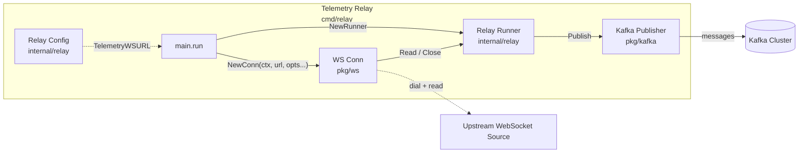

# Design

## Context

See `proposal.md` — Why, and `specs/telemetry/ws-connection/spec.md` for the behavior contract. The current shape that this design has to work with:

- `pkg/ws/ws.go` is the package's only file. `CoderDialer.Dial(ctx, url)` calls `websocket.Dial(ctx, url, nil)`, so every connection runs on library defaults, and the zero-value struct leaves no place to put configuration.
- `cmd/relay/main.go` is the only caller. It dials once and hands the connection to `relay.NewRunner`.
- The consumer-side `Conn` interface (`Read`, `Close`) lives in `internal/relay`; `pkg/ws` has no interface of its own.
- `internal/relay` owns env/flag loading; `pkg/ws` is configuration-agnostic and must stay that way.

Constraints: no new dependencies; `Read` keeps returning the frame type as a string alongside the payload; `Close` keeps `(code int, reason string)`; `cmd/telemetry-server` must be unaffected.

Diagram assumptions: Mermaid, lightweight C4 component level, matching the `flowchart` conventions already used in `architecture.md`.

## Goals / Non-Goals

**Goals:**
- A single construction path for the upstream connection that carries every configurable setting, with defaults that match or improve on today's behavior.
- Invalid configuration fails before any network activity, at the package boundary.
- The `Read`/`Close` contract the runner depends on stays exactly the same.

**Non-Goals:**
- Reconnection, backoff, or re-dial policy. The runner's behavior is unchanged; the dead-socket spin in `relay.Run` is a known defect handled by a separate change.
- Any change to `internal/relay`, new env vars or flags.
- TLS, proxy, or custom `http.Client` support; ping/idle keepalive.

## Decisions

### D1 — Functional options, with the endpoint as a required positional argument

`NewConn(ctx, url string, opts ...Option)` keeps the mandatory value in the signature, where the compiler enforces it, and leaves open-ended settings to options. Options read well at the single call site and avoid a struct where every caller must spell out defaults it does not care about.

*Alternatives:* a plain `Config` struct (rejected: the zero value is ambiguous — `0` read limit and "unset" look identical, forcing pointer or sentinel fields); passing `websocket.DialOptions` straight through (rejected: leaks the library's types into the package's contract and still leaves read limit, timeout, and logger to solve separately).

### D2 — Defaults that are safe for telemetry traffic

1 MiB read limit, 10s handshake deadline, compression off, no extra headers or subprotocols, no logger. The read limit is the one deliberate behavior change: the library's 32 KiB default rejects realistic telemetry frames with no recourse, and 1 MiB is still well inside the library's tolerance.

*Alternatives:* keep 32 KiB (rejected: reproduces the bug being fixed); unbounded reads (rejected: memory pressure from a misbehaving peer).

### D3 — Validation at construction, not on first read

The constructor rejects an empty endpoint, a non-positive deadline or read limit, and a compression threshold supplied while compression is disabled. This follows the project rule to validate at the edges: a bad configuration surfaces at startup with a specific message instead of mid-stream.

*Alternatives:* validate lazily in `Read` (rejected: turns a startup bug into a runtime failure after Kafka is already connected); validate nothing and let the library fail (rejected: the error would not name the offending setting).

### D4 — The interface stays with the consumer

`pkg/ws` exports the concrete `*Conn`; `internal/relay` keeps its own two-method interface. This is Go's consumer-owned-interface idiom and keeps the runner testable with fakes that never import `pkg/ws`.

*Alternatives:* move `Conn` into `pkg/ws` and have `internal/relay` import it (rejected: reverses the dependency for no gain, and every fake would have to satisfy the provider package).

### D5 — Logging is injected, and optional

`WithLogger(*slog.Logger)` records dial and close failures. With no logger the package logs nothing, so tests stay quiet and the binary decides verbosity through the existing logging setup.

*Alternatives:* use `slog.Default()` implicitly (rejected: surprising global coupling and noisy tests); return errors only and log nothing (rejected: operators lose the "which endpoint failed" line at startup).

### D6 — Remove `CoderDialer` outright

One caller exists in the repository; there is no compatibility surface worth preserving. A deprecated wrapper would keep a second, unconfigurable way to build the same object.

*Alternatives:* keep `CoderDialer` as a thin wrapper over `NewConn` (rejected: two APIs for one job, and the wrapper would hide the new defaults).

## Diagram

- The boundary this change moves is inside `cmd/relay`: `main.run` becomes the only place that knows how the connection is built.
- `pkg/ws` keeps no knowledge of env, flags, or the relay: it receives a URL and options.
- `internal/relay` is untouched, so the runner still sees exactly `Read` and `Close`.
- The publisher path is drawn for context only; it is unchanged by this change.

## Risks / Trade-offs

- **[1 MiB default admits frames the old limit rejected]** → intentional, and the limit is configurable; noted in the proposal as the one behavior change.
- **[Removing `CoderDialer` breaks any out-of-tree importer]** → only `cmd/relay/main.go` references it in this repository; it is a project-local package, and the removal is marked breaking.
- **[Options can express contradictory settings]** → the constructor validates the combinations it cannot reconcile (threshold without compression) and returns a naming error.
- **[`architecture.md` and ADR-0001 describe the old package path]** → ADR-0001 is amended in this change; the `architecture.md` component table still says `internal/utils/ws`, which is a docs-only follow-up outside the two-file code scope.
- **[The dead-socket spin in `relay.Run` remains]** → explicitly out of scope; recorded so it is not mistaken for fixed by the new constructor.

## Migration Plan

One commit: rewrite `pkg/ws/ws.go`, update the call site in `cmd/relay/main.go`, add table-driven tests for the option and validation paths. No configuration, state, or infrastructure changes, so rollback is a revert. The relay behaves as before apart from accepting frames up to 1 MiB.

## Open Questions

None blocking. Deferred by decision: reconnect policy (separate change) and the `architecture.md` component-path correction (docs-only).
