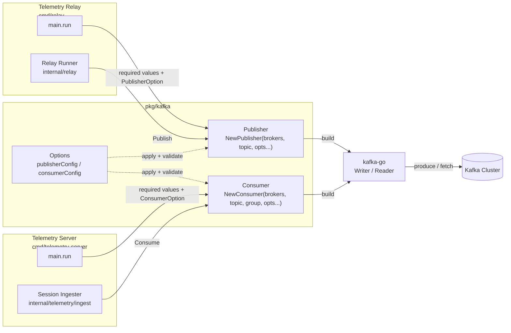

# Design

## Context

See `proposal.md` — Why, and `specs/telemetry/kafka-client/spec.md` for the behavior contract. The current shape this design works with:

- `pkg/kafka` has two files and no shared configuration type. `NewPublisher` builds a `kafka.Writer` with a fixed `LeastBytes` balancer and returns `(*Publisher, error)`; `NewConsumer` builds a `kafka.Reader` from three values and returns `*Consumer` with no error.
- `cmd/relay/main.go` is the only publisher caller. It wraps the constructor error and defers `Close`.
- `cmd/telemetry-server/main.go` is the only consumer caller. It uses the return value directly, so a fallible constructor changes that line.
- `kafka-go` treats zero values as "use the library default": `Writer` getters fall back when `MaxAttempts`, `BatchSize`, or `BatchTimeout` is not positive, and `ReaderConfig.StartOffset` of `0` means `FirstOffset`. `NewReader` panics when `ReaderConfig` fails validation.
- `pkg/kafka` imports the provider directly; no consumer-owned interface sits in front of it. Both binaries already depend on the package, not on `kafka-go`.

Constraints: no new dependencies; message payloads, the relay loop, and ingest behavior are unchanged; only `pkg/kafka` plus the single consumer call site change.

Diagram assumptions: Mermaid, lightweight C4 component level, matching the `flowchart` convention in `docs/architecture.md` and the WebSocket constructor design.

## Goals / Non-Goals

**Goals:**
- One construction path per adapter that carries every optional setting, with the required values still enforced by the compiler.
- Omitted options reproduce today's behavior exactly, including `LeastBytes` and the library defaults.
- Invalid configuration fails at the package boundary with an error naming the setting, before any `kafka-go` object exists.
- Callers keep provider types out of their code: no `kafka.RequiredAcks` or raw offset integers at call sites.

**Non-Goals:**
- Exposing every `Writer`/`ReaderConfig` field. The option set stays limited to delivery and fetch tuning.
- Retry policy, idempotent production, transactions, or consumer commit strategy. Those are separate concerns from construction.
- A logger option. Neither binary has a logging need inside `pkg/kafka` today.
- Env or flag changes. The binaries decide which options to pass; `pkg/kafka` stays configuration-agnostic.

## Decisions

### D1 — Functional options appended to the existing constructors

`NewPublisher(brokers []string, topic string, opts ...PublisherOption)` and `NewConsumer(brokers []string, topic string, groupID string, opts ...ConsumerOption)` keep the mandatory values positional, where the compiler enforces them, and leave open-ended tuning to options. This mirrors ADR 0007's WebSocket decision and keeps the publisher call site source-compatible.

*Alternatives:* a `Config` struct per adapter (rejected: every caller must spell out fields it does not care about, and zero values would silently mean "default"); a single generic option type (rejected: it would let publisher-only settings reach the consumer and vice versa).

### D2 — Package-owned types for acknowledgements and start offset

`RequiredAcks` and `StartOffset` are the two options whose underlying values are provider enums, not plain magnitudes. The package defines its own types and constants:

- `AcksNone`, `AcksLeader`, `AcksAll` for the acknowledgement level.
- `StartOffsetDefault`, `StartOffsetFirst`, `StartOffsetLast` for the start offset.

The constructors translate these to `kafka.RequiredAcks` and `kafka-go`'s `FirstOffset`/`LastOffset`. Callers never import `kafka-go`, and arbitrary integers cannot reach `ReaderConfig`, which is what makes the unsupported-offset scenario testable without touching the provider.

*Alternatives:* accept `kafka.RequiredAcks` and `int64` directly (rejected: leaks the provider into the public contract and permits invalid offsets until the library panics); accept plain integers with range checks (rejected: `-1` reads as a magic number and still couples callers to provider semantics).

### D3 — Options validate themselves; the constructor stops at the first error

Each option is a function returning an error. It validates its argument and writes it into an unexported config struct. The constructor applies defaults, then each option in order, and returns the first error wrapped with the constructor name. This keeps every rule next to the value it governs and makes each validation case unit-testable without building a writer.

Magnitude options (`MaxAttempts`, `BatchSize`, `BatchTimeout`, `MinBytes`, `MaxBytes`, `MaxWait`) require a positive value. Non-positive input is rejected rather than silently mapped to the library default, because zero would otherwise erase the caller's intent. Enum options accept only their defined constants.

*Alternatives:* validate after all options are applied (rejected: rules drift away from the option definitions and the config struct needs sentinels); let `kafka-go` fail later (rejected: `NewReader` panics, and the error would not name the setting).

### D4 — Defaults are the provider's zero values plus the existing balancer

The publisher config starts with `LeastBytes` and zero-valued tuning fields; the consumer config starts with zero-valued fetch fields. Because `kafka-go` reads zero as "use its default", an omitted option produces exactly today's behavior without a second defaults table that could drift from the library. The only non-zero default is the balancer the package already chose.

*Alternatives:* copy the library's numeric defaults into `pkg/kafka` (rejected: duplicates upstream values and silently changes behavior when the dependency changes); require every caller to pass a full configuration (rejected: turns optional tuning into noise at both call sites).

### D5 — The consumer constructor becomes fallible; validation precedes reader creation

`NewConsumer` returns `(*Consumer, error)`. It validates the required broker list, topic, and group first, then applies options, then runs the provider's `ReaderConfig.Validate`, and only then constructs the reader. Validation therefore always runs before the call that panics on a bad `ReaderConfig`. `cmd/telemetry-server/main.go` wraps the new error as `create kafka consumer: %w` and returns it, matching how the relay already handles its publisher.

*Alternatives:* keep the infallible signature and restrict consumer options to values that cannot fail (rejected: no useful tuning is guaranteed safe, and required-value errors would still be unreportable); recover from the panic (rejected: hides programming errors and loses the setting name).

### D6 — Options live in one package-local file

A single `pkg/kafka/options.go` holds `PublisherOption`, `ConsumerOption`, their config structs, the package-owned enum types, and every `With...` function. `publisher.go` and `consumer.go` keep only construction and the `Publish`/`Consume`/`Close` methods. One file keeps the supported surface reviewable at a glance.

*Alternatives:* split into `publisher_options.go` and `consumer_options.go` (rejected: two small files with duplicated shape for a package this size); define options next to each constructor (rejected: scatters the shared validation rules).

### D7 — Tests assert the built object, in-package, without a broker

Tests live in `pkg/kafka` alongside the source. They call the constructors and read back the resulting `Writer` fields or `Reader.Config()`. Because both constructors build without dialing, no Kafka instance is needed. Table-driven cases cover each option, each rejected value, and the omitted-option defaults.

*Alternatives:* integration tests against a broker (rejected: construction does not connect, so a broker adds cost without coverage); export configuration accessors for tests (rejected: grows the public API for tests only).

## Diagram

- The boundary this change moves is inside `pkg/kafka`: each constructor becomes the only place that knows which provider fields exist.
- Options are applied before any `kafka-go` object is created, so a rejected value never reaches `NewReader`.
- `cmd/relay` passes no options and keeps its current call unchanged; `cmd/telemetry-server` gains one error check.
- `internal/relay` and `internal/telemetry/ingest` are untouched: they still see `Publish`/`Consume`/`Close`.

## Risks / Trade-offs

- **[Silent fallback if a caller passes zero]** → magnitude options reject non-positive values, so intent cannot collapse into a library default.
- **[Provider defaults can change between `kafka-go` upgrades]** → accepted: D4 deliberately tracks the library so the package never claims a default it does not enforce; behavior changes surface as a dependency change, not a hidden constant.
- **[`MinBytes` requires `MaxBytes` to be set]** → `kafka-go` validates `MinBytes <= MaxBytes` before applying its `MaxBytes` default, so a minimum supplied alone is invalid; the constructor runs that validation and returns the error before `NewReader` instead of panicking. Callers set both fetch bounds together.
- **[`NewConsumer` signature is breaking for any out-of-tree caller]** → one call site exists in this repository and is updated; the change is marked **BREAKING** in the proposal.
- **[Construction success does not prove the brokers exist]** → `kafka-go` dials lazily, as it does today; startup still succeeds and the first write or read reports connectivity.
- **[The public enum types add surface area]** → they are three constants each, and they are what keeps provider types out of the call sites.

## Migration Plan

One commit: add `pkg/kafka/options.go`, extend both constructors, update the consumer call site in `cmd/telemetry-server/main.go`, and add table-driven tests. No configuration or infrastructure changes, so rollback is a revert. The relay passes no options and behaves as before; the server behaves as before once the new error check is in place.

## Open Questions

None blocking. ADR 0008 records the constructor pattern once this design is accepted.
