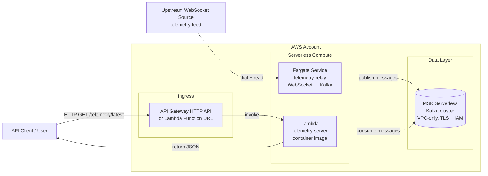
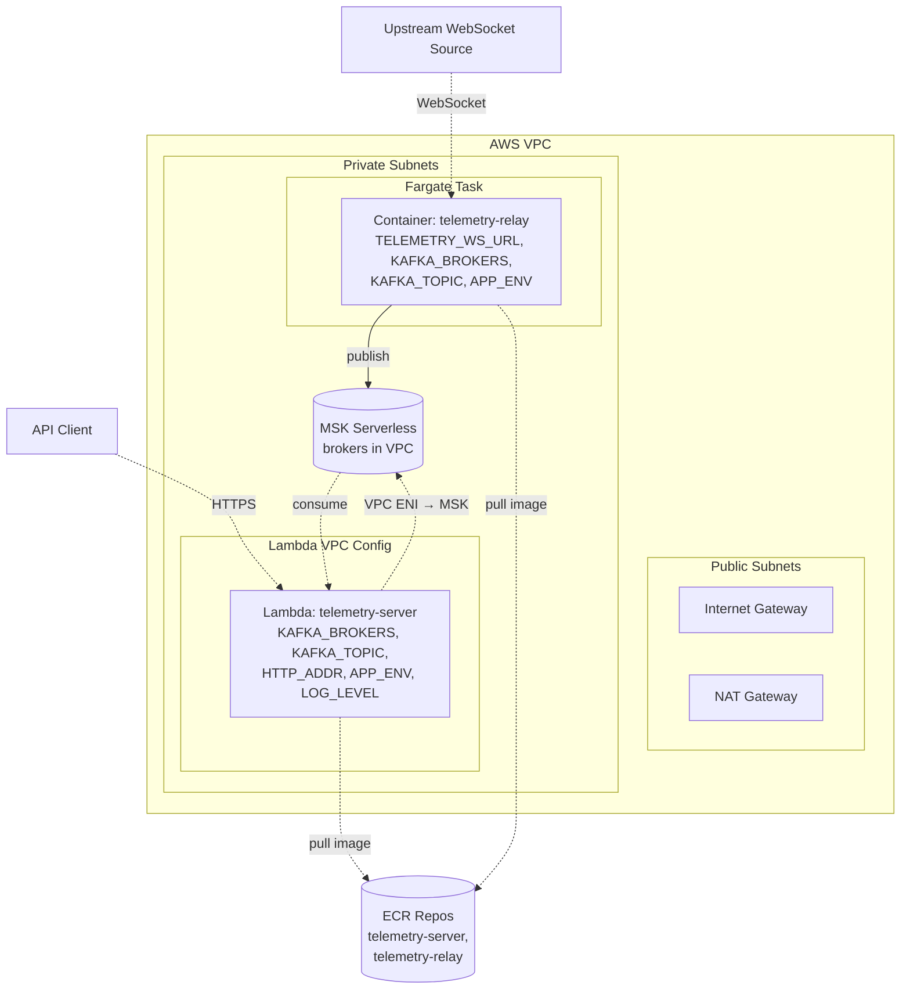

# Design

## Context

The telemetry system consists of two Go binaries: `cmd/relay` (WebSocket → Kafka publisher) and `cmd/telemetry-server` (Kafka consumer + HTTP API on `:8080`). Both are containerizable. Dev uses Docker Compose Kafka (PLAINTEXT). There is no AWS deployment path yet. See `proposal.md` for motivation.

Constraints:
- Relay cannot run on Lambda (long-lived upstream WebSocket; 15-min Lambda timeout)
- telemetry-server fits Lambda (HTTP request/response, container image support)
- MSK Serverless is VPC-only, requires TLS + IAM/SASL auth; current Kafka clients use PLAINTEXT

## Goals / Non-Goals

**Goals:**
- Provision AWS infrastructure via Terraform for dev/stage/prod
- Deploy telemetry-server on AWS Lambda (container image)
- Deploy relay on AWS Fargate (long-running Service, desiredCount=1)
- Provision MSK Serverless as the Kafka backend
- Offer two ingress options for the Lambda: API Gateway HTTP API (option-a) and Lambda Function URL (option-b)
- Isolate environments with separate state

**Non-Goals:**
- No Go code changes (infra-only)
- No changes to existing spec requirements or capabilities
- No Lambda for the relay
- No persistent storage beyond Kafka (ring buffer remains ephemeral, consistent with ADR 0002)

## Decisions

### D1: Lambda (container image) for telemetry-server

**Why:** HTTP request/response workload matches Lambda's invocation model; container image support lets us reuse the existing Dockerfile pattern (multi-stage, distroless runtime).

**Alternatives:**
- Fargate for server: rejected — over-provisions compute for a request/response API; no scale-to-zero.
- Lambda ZIP binary: rejected — container image aligns with existing Dockerfile and ECR strategy.

### D2: Fargate Service for relay

**Why:** Relay maintains a long-lived WebSocket connection to an upstream source and continuously publishes to Kafka. Lambda's 15-min timeout and lack of persistent inbound connections make it unsuitable. Fargate Service (desiredCount=1, always-on restart) keeps the socket alive.

**Alternatives:**
- Lambda for relay: rejected — 15-min timeout, no persistent WebSocket.
- EC2 for relay: rejected — not serverless, more ops overhead.

### D3: Two Terraform option folders

**Why:** Option-a (API Gateway HTTP API) offers richer features (auth, usage plans, stages). Option-b (Lambda Function URL) is simpler and cheaper. Both share the same backend (Fargate relay + MSK).

**Structure:**
```
terraform/
  option-a-lambda-apigw/   # Lambda + API Gateway HTTP API
  option-b-lambda-functionurl/  # Lambda + Lambda Function URL
  modules/                 # shared: vpc, msk-serverless, ecr, iam, security-groups, ecs-fargate-relay
```

### D4: MSK Serverless for Kafka

**Why:** Managed Kafka that matches the "serverless" goal; no broker capacity planning.

**Trade-off:** VPC-only (no public brokers) and requires TLS + IAM/SASL auth. Current clients use PLAINTEXT — this is the main config/auth gap (see Risks).

### D5: Directory-per-env (dev/stage/prod)

**Why:** Isolated state per environment prevents cross-environment blast radius. Each env has its own `terraform.tfvars` and backend state key.

### D6: ECR for container images

**Why:** Both Lambda (container image) and Fargate pull from ECR. Two repos: `telemetry-server`, `telemetry-relay`.

## C4 Diagrams

### System Context



**Boundaries:** AWS account contains all resources. Upstream WebSocket source is external (operator-provided URL). API clients reach Lambda via the chosen ingress (API GW or Function URL).

**Responsibilities:**
- Lambda: serve `GET /telemetry/latest` from in-memory ring buffer (populated from Kafka)
- Fargate relay: dial upstream WebSocket, publish records to MSK
- MSK Serverless: durable message bus between relay and server

**Assumptions:** Lambda and Fargate run in VPC private subnets with NAT for outbound; MSK in private subnets.

**Open questions:** MSK auth mechanism (IAM vs SASL/SCRAM) — see Risks.

### Container



**Containers:**
- `telemetry-server` Lambda — container image from ECR, env vars from Secrets Manager / SSM
- `telemetry-relay` Fargate task — container image from ECR, env vars including `TELEMETRY_WS_URL`
- `MSK Serverless` — managed Kafka, VPC private subnets

**Networking:** Lambda and Fargate in private subnets; NAT Gateway for ECR/image pulls and any outbound; security groups restrict Lambda↔MSK and Fargate↔MSK.

## Risks / Trade-offs

| Risk | Mitigation |
|------|------------|
| [MSK Serverless requires TLS + IAM/SASL auth; current Kafka clients use PLAINTEXT] | Resolve Kafka client config (SASL/IAM or SCRAM) before apply; may require Go code change to relay/server Kafka clients |
| [Lambda cold start affects `GET /telemetry/latest` latency] | Provisioned concurrency option; acceptable for telemetry query workload |
| [VPC networking complexity (private subnets, NAT, SG rules)] | Shared `vpc` module with tested SG rules; document per-env |
| [Relay Fargate task loses upstream WebSocket on deployment] | Fargate Service rolling update; reconnect loop handles transient disconnects (ADR 0006) |
| [Ring buffer is ephemeral; Lambda invocations may not share buffer state] | Each Lambda invocation reads fresh from Kafka; buffer is per-invocation (consistent with ephemeral design) |

## Migration Plan

1. Provision shared modules (VPC, MSK Serverless, ECR, IAM, security groups) per environment
2. Build and push `telemetry-server` and `telemetry-relay` container images to ECR
3. Deploy Lambda function + ingress (API GW or Function URL) for `telemetry-server`
4. Deploy Fargate Service for `telemetry-relay`
5. Configure env vars (`KAFKA_BROKERS`, `KAFKA_TOPIC`, `TELEMETRY_WS_URL`, `APP_ENV`, `LOG_LEVEL`)
6. Validate: `GET /telemetry/latest` returns records; relay publishes to MSK
7. Rollback: `terraform destroy` per environment or revert Terraform version

## Open Questions

- MSK auth mechanism: IAM auth vs SASL/SCRAM — affects Kafka client config and IAM policies
