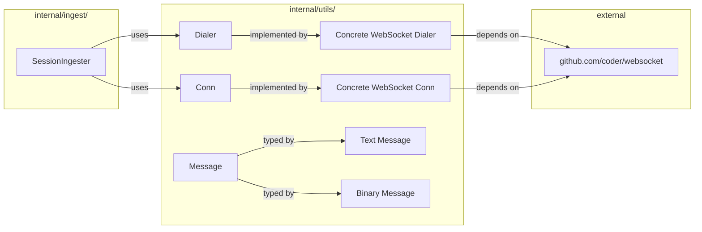

# Design

## Context

This change refactors the WebSocket ingestion components to decouple the connection interface from the implementation. The motivation is documented in `proposal.md`. 

**Current state**: `internal/ingest/ws.go` and `internal/ingest/ingest.go` contain concrete WebSocket types (`MessageType`, `Message`, `Conn`, `Dialer`) that tightly couple the ingester to a specific WebSocket library (`github.com/coder/websocket`).

**Desired state**: The WebSocket interface (`Dialer`, `Conn`, `Message`, `MessageType`) lives in `internal/utils/` as a technology-agnostic contract. The `SessionIngester` depends on the `Dialer` interface, enabling technology swaps without modifying the ingester core.

**Constraints**:
- Must preserve existing `SessionIngester` behavior
- Must maintain the retry mechanism with exponential backoff + jitter
- Must not break existing test expectations
- The `internal/ingest/retry.go` should use the shared `utils.WithRetry` mechanism

**Existing architecture**: The system uses a spec-driven OpenSpec workflow with artifacts: proposal → specs → design → tasks. This change fits as a technology refactoring within the existing architecture.

## Goals / Non-Goals

**Goals**:
- Decouple WebSocket implementation from ingester core
- Move interface types (`Conn`, `Dialer`, `Message`, `MessageType`) to `internal/utils/`
- Refactor `SessionIngester` to depend on `Dialer` interface
- Use shared `utils.WithRetry` for connection retry logic
- Preserve all existing functionality and test expectations

**Non-Goals**:
- Changing the WebSocket library version or type (just the interface)
- Adding new features or capabilities
- Modifying the ingest behavior or message processing
- Changing the OpenSpec workflow or artifact structure

## Decisions

### Decision 1: Interface extraction
**Rationale**: By moving the WebSocket types to a shared utility package, other packages can depend on the interface without pulling in WebSocket dependencies. This enables technology flexibility.

**Alternative**: Keep types in `internal/ingest/` and accept the coupling.
**Choice**: Interface extraction for long-term maintainability.

### Decision 2: Shared retry mechanism
**Rationale**: The `utils.WithRetry` function provides consistent exponential backoff + jitter across the codebase (already used by `kafkaPublisher.Publish`). Using the same mechanism in `internal/ingest/retry.go` ensures consistent behavior.

**Alternative**: Keep the retry logic duplicated in `internal/ingest/retry.go`.
**Choice**: Shared mechanism for consistency and reduced duplication.

### Decision 3: Interface-based dependency
**Rationale**: `SessionIngester` depending on `Dialer` interface rather than concrete type enables testing with mocks and technology swaps.

**Alternative**: Keep `SessionIngester` dependent on concrete `Conn` type.
**Choice**: Interface-based for testability and flexibility.

## Risks / Trade-offs

| Risk | Mitigation |
|------|------------|
| Tests fail due to interface changes | Update test mocks to implement `Dialer` interface; the interface is minimal and stable |
| Other packages break from type moves | Audit `go list -recursive` for internal/ingest imports; update as needed |
| Retry behavior changes | `utils.WithRetry` parameters (100ms base, 5s max, 1s successMin) match existing `internal/ingest/retry.go` values |

## Migration Plan

1. Move `MessageType`, `Message`, `Conn` interface, `Dialer` interface from `internal/ingest/ws.go` to `internal/utils/`
2. Update `internal/ingest/ingest.go` to import `Dialer` from `internal/utils` instead of using concrete types
3. Update `internal/ingest/retry.go` to use `utils.WithRetry` instead of duplicate logic
4. Update all internal imports and rebuild
5. Run tests to verify behavior preservation

## Open Questions

- None - all decisions are documented and the interface is minimal enough that no unresolved questions remain.

## C4 Diagrams

