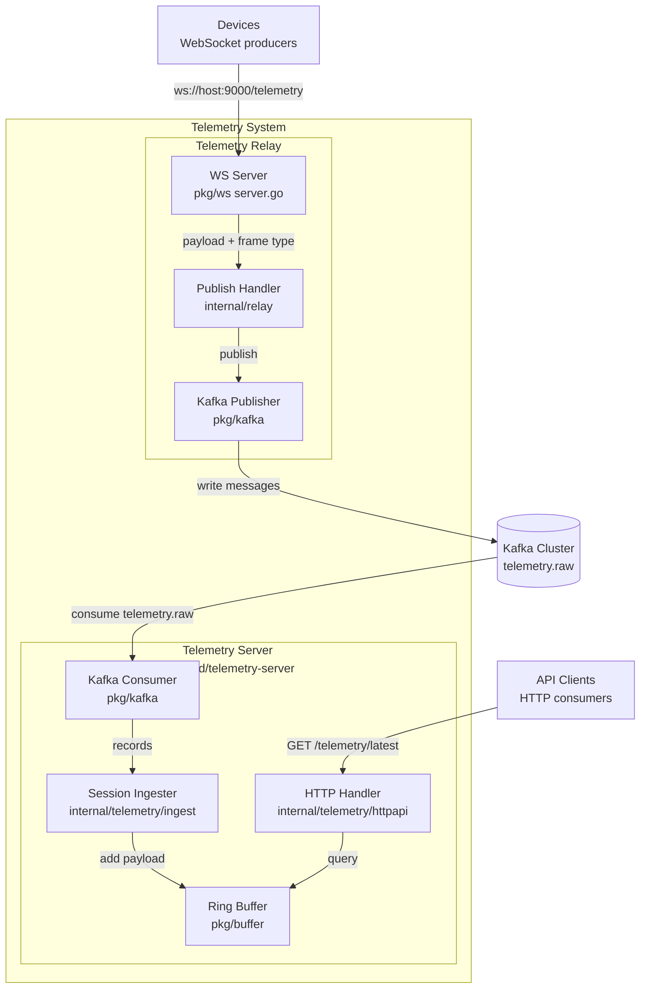

# Design

## Context

See `proposal.md` for motivation and the spec deltas under `specs/` for the behavioral contract. Current state that shapes the approach:

- `pkg/ws/ws.go` is a complete dialing client (`NewWebsocket`, functional options, `Read`, `Close`). It must stay as-is; the server is additive in a new file.
- `cmd/relay/main.go` dials `cfg.TelemetryWSURL` once and hands the connection to `internal/relay.Runner`, which loops over a single connection. The process exits when that connection fails.
- `internal/relay/config.go` requires `TELEMETRY_WS_URL`; `internal/relay/config_test.go` asserts that requirement.
- `pkg/kafka.Publisher.Publish` already retries per the writer's `MaxAttempts`; `internal/relay.Publisher` is the test seam around it.
- `cmd/telemetry-server` currently exposes only `GET /telemetry/latest`; the earlier `/ws` ingest wiring is not present in the working tree, and `pkg/wsingest/` is an empty leftover directory.
- `docs/architecture.md` still describes an external "Upstream WebSocket Source" and references pre-move package paths (`internal/utils/ws`, `internal/utils/kafka`).

## Goals / Non-Goals

**Goals:**

- Make relay the single WebSocket ingest endpoint: `device → relay (:9000 /telemetry) → Kafka → telemetry-server → HTTP`.
- Keep the WebSocket lifecycle (accept, read, limit, close taxonomy, shutdown) inside `pkg/ws`, and the telemetry business rule (publish or fail) inside `internal/relay`.
- Make startup, shutdown, and per-connection failure behavior deterministic and testable without a real Kafka broker.

**Non-Goals:**

- No TLS, authentication, origin allowlisting, or per-device authorization for the ingest endpoint. The existing system has none; adding it is a separate change.
- No server-side buffering or retry queue while Kafka is unavailable. The Kafka writer's own retries remain; after they are exhausted the connection is closed.
- No protocol negotiation, subprotocols, ping/pong policy, or message schema validation. Payloads are forwarded unchanged.
- No change to `telemetry-server` ingestion, buffering, or HTTP behavior beyond confirming the `/ws` path is gone.

## Decisions

### 1. Server is a new file in `pkg/ws`, next to the client

`pkg/ws/server.go` adds `Server`, `ServerOption`, `MessageHandler`, `NewServer`, and `Server.Run`. The client file is untouched. Both directions share the package because they share the `coder/websocket` dependency, read-limit default, and close-code vocabulary.

*Alternatives considered:* a separate `pkg/wsserver` package (duplicates defaults and dependency wiring, and the user asked for a server in `pkg/ws`); rewriting `ws.go` in place (loses the working client, explicitly rejected).

### 2. The handler boundary is a concrete function type, not an interface

```go
type MessageHandler func(ctx context.Context, messageType string, payload []byte) error
```

The server owns transport concerns; the handler owns the business action. `messageType` mirrors the client's `Read` return (`"text"`/`"binary"`) so the server contract does not expose `websocket.MessageType`. Returning an error means "the message was not accepted"; the server turns that into a close. `NewServer` rejects a nil handler.

*Alternatives considered:* an interface (would exist only to be swapped, with one implementation); passing a `kafka.Publisher` into `pkg/ws` (couples the transport package to a broker and makes `pkg/ws` untestable in isolation); a handler that returns `(closeCode, reason)` (leaks close-code policy into every caller).

### 3. Fixed `/telemetry` route with an explicit listener

`NewServer(addr, handler, opts...)` stores `WSAddr` and the handler. `Run(ctx)` calls `net.Listen` first, so an unusable address returns a startup error instead of failing inside a goroutine, then serves an `http.ServeMux` with exactly one route: `GET /telemetry` upgraded via `websocket.Accept`. Any other path falls through to 404 and is never upgraded. The path is a package constant, not configuration (per the approved decision).

`Run` returns the bound address through `Server.Addr()` so callers and tests can log or dial `:0` listeners.

*Alternatives considered:* `http.ListenAndServe` (bind errors arrive asynchronously and are awkward to distinguish from shutdown); making the path configurable (explicitly declined); a raw `net.Listener` accept loop (reimplements HTTP routing, header limits, and handshake handling that `net/http` already provides).

### 4. Concurrency is one goroutine per connection; shutdown closes tracked connections

`net/http` already serves each connection in its own goroutine, so concurrent devices need no worker pool. The server keeps the set of live upgraded connections behind a mutex. On `ctx` cancellation `Run`:

1. Marks the server closing so new handshakes are refused.
2. Closes every tracked connection with `StatusGoingAway` (1001) and a reason, unblocking handlers parked in `Read`.
3. Calls `http.Server.Shutdown` with a bounded timeout, then `Close` if it overruns.
4. Returns `nil` for a requested shutdown, or the listen/serve error otherwise.

Explicit tracking is required because `http.Server.Shutdown` does not wait for hijacked (upgraded) connections.

*Alternatives considered:* relying only on `Shutdown` (hijacked connections are never closed and handlers leak); relying on the request context (cancelled on client disconnect, not on server shutdown); a single goroutine multiplexing all devices (unnecessary complexity).

### 5. Close taxonomy is centralized in the server

| Situation | Close sent |
|---|---|
| Client closes normally (`CloseStatus == StatusNormalClosure`) | none; release and continue |
| Read error with a valid close status (e.g. 1009 message too big) | that status with a short reason |
| Read error without a usable status | 1011 |
| Handler error (Kafka publish exhausted) | 1011 with an error reason |
| Server shutdown | 1001 "server shutting down" |

Reads use the configured limit (default `DefaultReadLimit`, 1 MiB). A limit breach surfaces as a read error before any payload is handed to the handler, satisfying "no truncated payload is processed".

*Alternatives considered:* a fixed 1000 or 1011 for all failures (hides message-too-big from the device); closing with 1001 for handler failures (misleading, since the server is still running).

### 6. Relay publishes through a handler; the single-connection runner is removed

`internal/relay/handler.go` adds:

```go
type Handler struct { publisher Publisher }
func (h *Handler) Handle(ctx context.Context, messageType string, payload []byte) error
```

`Handle` ignores `messageType` and publishes `payload` unchanged, wrapping failures with context. `Publisher` stays as the interface (`Publish`, `Close` is dropped from it and handled in `main`). `Runner` and its `Conn` interface are deleted: they encode "exactly one upstream connection, reconnect forever", which is now false, and keeping them would leave an unused second ingest path.

`cmd/relay/main.go` becomes: load config → logger → publisher → `ws.NewServer(cfg.WSAddr, relayHandler.Handle, ws.WithServerLogger(logger))` → `Run(ctx)` with signal-derived context. Shutdown closes the publisher after the server stops, so no handler can publish into a closed writer.

*Alternatives considered:* keeping `Runner` and having the server call `Runner.Run` per connection (the runner's reconnect semantics are wrong per connection); keeping `Runner` unused for compatibility (dead code that contradicts the specs).

### 7. Configuration validates shape early, bind stays authoritative

`Config` drops `TelemetryWSURL`, adds `WSAddr` with default `:9000`, env `WS_ADDR`, and flag `-ws-addr`. After defaults, `Load` validates the address with `net.SplitHostPort`, which catches a missing port or malformed host with a clear message before Kafka setup. Whether the address is actually bindable remains the listener's job, reported by `Run` and wrapped by `main`.

*Alternatives considered:* validating only at bind time (correct but later, after publisher construction); `net.ResolveTCPAddr` (performs DNS resolution at config time and can fail for valid-but-not-yet-resolvable hosts).

### 8. Target container view



- **Boundaries:** relay is one deployable unit holding both transport and publish concerns; telemetry-server is unchanged and still owns the HTTP read model.
- **Responsibilities:** `pkg/ws` admits connections and enforces message/close rules; `internal/relay` decides whether a message was accepted; `pkg/kafka` owns broker delivery.
- **Key relationship:** Kafka remains the durable buffer between relay and server, so the two binaries still scale and restart independently.
- **Assumption:** the relay is reachable by devices at `WS_ADDR`; local dev uses `:9000` on the host.
- **Open question deferred to deployment work:** exposing `:9000` beyond localhost requires TLS and authentication, which this design does not add.

## Risks / Trade-offs

- **Kafka outage drops in-flight records** → The writer already retries with backoff; after exhaustion the relay closes only that connection (1011) and logs it. Devices must resend. Accepted trade-off recorded in ADR-0009; durable buffering stays Kafka's job.
- **One shared `kafka.Writer` across connections** → `segmentio/kafka-go` writers are safe for concurrent `WriteMessages`; batching may coalesce records from different devices, which Kafka consumers already tolerate because payloads are self-describing.
- **Shutdown can still overrun** → Connection closes unblock reads first; `Shutdown` is bounded, then forced `Close`. A wedged handler cannot hold the process open indefinitely.
- **`:9000` has no auth/TLS** → Local-only default in docs; no public exposure is introduced by this change. Flagged as a prerequisite for any non-local deployment.
- **Documentation across active changes drifts** → `docs/architecture.md`, README, and `.env.example` are updated here; other in-flight changes (`aws-serverless-terraform`) still mention `TELEMETRY_WS_URL` and are out of scope.
- **Config is a breaking change** → Startup fails fast with `KAFKA_BROKERS`/`WS_ADDR` guidance; the removed `-telemetry-ws-url` flag is no longer registered, so stale invocations fail visibly rather than silently.

## Migration Plan

1. Replace `TELEMETRY_WS_URL` with `WS_ADDR=:9000` in `.env.example`, local `.env`, and compose/README examples.
2. Deploy the relay binary and restart it; verify `relay` logs the listen address and `make device` (now `ws://localhost:9000/telemetry`) produces records visible via `GET :8080/telemetry/latest`.
3. Point devices at the new endpoint; the old upstream URL is no longer dialed, so no dual-run period is needed.
4. Confirm `pkg/wsingest` is gone and telemetry-server serves only its HTTP routes.
5. Rollback: restore the previous relay binary and `TELEMETRY_WS_URL`; no schema, migration, or stored-data changes are involved.

## Open Questions

- Should the relay expose a readiness endpoint or log a structured "listening" event that orchestration can probe? Deferrable; current behavior logs the address.
- Should `WS_ADDR` gain a TLS/auth companion configuration when deployed outside localhost? Deferrable to the deployment change.
